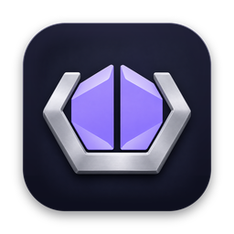
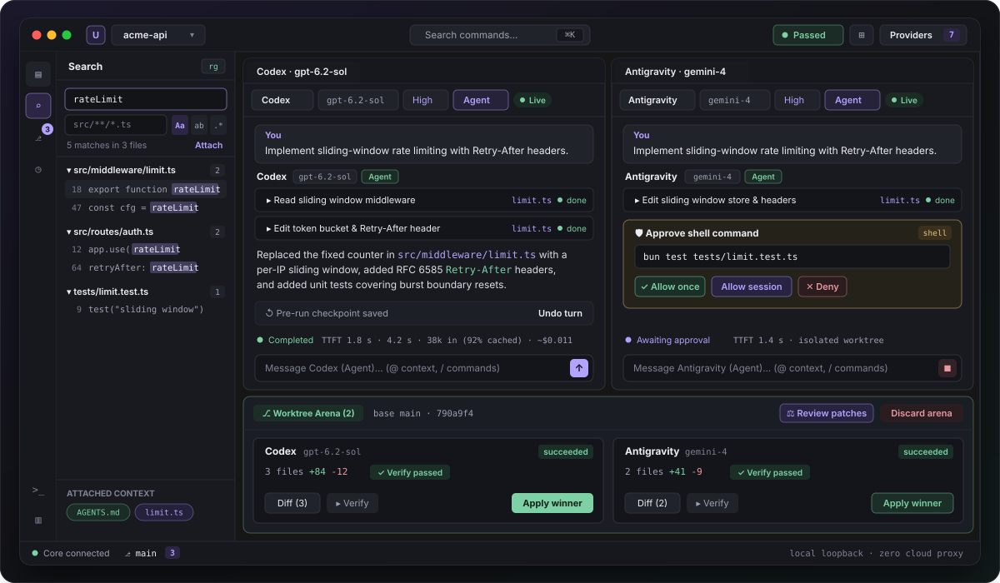
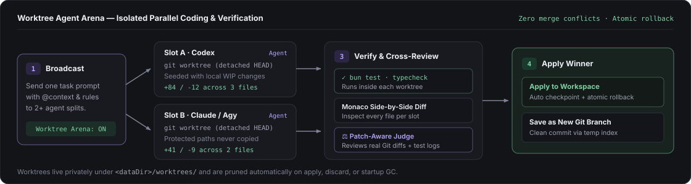

<p align="center">
  
</p>

<h1 align="center">Uya</h1>

<p align="center">
  <strong>macOS және Windows 10/11 жүйелеріне арналған жергілікті (local-first) көп агентті AI-жұмыс ортасы.</strong><br />
  Codex, Claude Code, Antigravity, Gemini, OpenCode және жергілікті модельдерді бір терезеде қатар іске қосыңыз — жобаны тікелей зерттеу, оқшауланған Git Worktree Arena, inline растау карточкалары, ripgrep іздеуі, толық Git клиенті және қайтарылатын бақылау нүктелері (checkpoints) бірге.
</p>

<p align="center">
  <em>Атауы қазақтың <strong>«ұя»</strong> сөзінен шыққан — барлық кодтау агенттеріңізге арналған бірыңғай тыныш мекен.</em>
</p>

<p align="center">
  <a href="README.md">English</a> · <a href="README.kk.md"><strong>Қазақша</strong></a> · <a href="docs/arena.md">Worktree Arena</a> · <a href="docs/providers.md">Провайдерлер</a> · <a href="docs/architecture.md">Архитектура</a> · <a href="docs/security.md">Қауіпсіздік</a>
</p>

<p align="center">
  <a href="https://github.com/akenoowww/uya/releases/latest"></a>
  <a href="https://github.com/akenoowww/uya/actions/workflows/ci.yml"></a>
  
  
  <a href="LICENSE"></a>
</p>

<p align="center">
  
</p>

---

## Неге Uya?

Қазіргі AI-әзірлеуде бір ғана модельмен шектелу сирек кездеседі. Бір тапсырманы **Codex** жүзеге асырса, шеткі жағдайларды **Claude Code** рефакторинг жасайды, қауіпсіздікті **Antigravity** тексереді, ал оффлайн эксперименттерді **Ollama** немесе **MLX** атқарады — әрі бәрі сіздің дайын CLI-жазылымдарыңыз бен жергілікті салмақтарыңыз арқылы.

Бес терминал қойындысы мен браузер терезелерінің арасында ауысып жүргенше, **Uya** барлық агенттерді бір нативті Tauri жұмыс ортасында біріктіреді: тірі сессияларды сақтайды, нақты рұқсат шекараларын ұстанады және негізгі бұтағыңызға тиіспей тұрып агенттерді оқшауланған Git worktree-лерде жарыстырып тексеруге мүмкіндік береді.

- **Бұлтты проксисіз, қосымша аккаунтсыз**: Орнатылған CLI-авторизацияларыңыз бен `127.0.0.1` жергілікті серверлерін тікелей пайдаланады.
- **Айқын қауіпсіздік режимдері**: Әр сплитте **Isolated**, **Explore (тек оқу)** және **Agent (өңдеу + растау)** арасында лезде ауысыңыз.
- **Күнделікті жұмысқа дайын**: Ripgrep іздеуі, AI коммит-хабарламасы бар толық Git клиенті, көп файлды Monaco Diff/Apply, бір батырмалы Verify тексеруі және қадамды қайтару (`/undo`).

---

## Негізгі мүмкіндіктер

### 1. Әр сплитке арналған 3 қолжетімділік режимі

| Режим | Жұмыс папкасы | Құралдарға рұқсат | Қорғаныс тетіктері | Қолдану аясы |
| --- | --- | --- | --- | --- |
| **Isolated** (`Chat`) | Уақытша `mkdtemp` папкасы | `0` құрал; тек нақты `@context` | Файл жүйесінен толық оқшаулау | Құпия код үзінділері, таза сұрақ-жауап, жергілікті HTTP-модельдер |
| **Explore** (`Read-Only`) *(жоба ашылғанда әдепкі)* | Ашық жоба папкасы | Файлдарды оқу, glob, іздеу | Барлық жазу және өзгерту пәрмендері бұғатталады | Кодты зерттеу, қате іздеу, архитектуралық шолу |
| **Agent** (`Edit`) | Ашық жоба папкасы (немесе Worktree Arena слоты) | Оқу, іздеу, файл өңдеу, shell | **Inline растау карточкалары** (`Allow once` / `Allow session` / `Deny`) + **автоматты бақылау нүктесі (checkpoint)** | Фичаларды жазу, тесттер қосу, рефакторинг |

> Статлес провайдерлер мен жергілікті HTTP-модельдер (`Ollama`, `llama.cpp`, `MLX`, `LM Studio`, `Gemini API`, `Qwen Code`) үшін **Workspace Map** қосылғанда, Uya ықшам (<= 6 КиБ) жоба құрылымын (`@workspace-map`) автоматты тіркейді.

---

### 2. Worktree Agent Arena (оқшауланған параллель кодтау)

Broadcast композерінде (`⌘⇧B` / `Ctrl+Shift+B` немесе `/arena on`) **Worktree Arena** режимін қосыңыз: бір тапсырманы екі не одан көп агентке қатар жібергенде, әрқайсысы **өзінің оқшауланған `git worktree` көшірмесінде** жұмыс істейді.

<p align="center">
  
</p>

- **Қақтығыссыз параллельдік**: Әр сплит `<dataDir>/worktrees/` ішінде бөлек worktree алады (аяқталмаған жергілікті WIP өзгерістері көшіріледі, ал `.env*` және кілттер ешқашан көшірілмейді).
- **Әр нұсқаны тестпен тексеру**: Автоматты табылған командаларды (`bun test`, `tsc`, `cargo test`, `pytest`) әр worktree ішінде бөлек іске қосыңыз.
- **Патч бойынша арбитр (Judge)**: **Review patches** (`/judge`) батырмасы барлық үміткерлердің **нақты Git diff-ін** және тест нәтижелерін арбитр модельге жібереді.
- **Жеңімпазды қауіпсіз қолдану**: Негізгі папкаға автоматты бақылау нүктесімен (қате болса — толық кері қайтарумен) қолданыңыз немесе таза жаңа Git бұтағы ретінде сақтаңыз.

Толық нұсқаулық: [docs/arena.md](docs/arena.md).

---

### 3. Тұрақты сессиялар, құрал карточкалары және `/undo`

- **Тірі сессиялар мен промпт кэші**: ACP агенттері (`agy`) `AcpSessionPool` пулында жылы күйде сақталады, ал **Codex** пен **Claude Code** нативті CLI-сессияларды жалғастырады — кэш үлесі (`92% cached`) мен шамамен құны транскрипт пен Usage бөлімінде көрінеді.
- **Құрылымдалған Tool-карточкалар және inline растаулар**: Агенттің оқу, іздеу, өңдеу немесе shell пәрмендерін басып ашылатын карточкалардан бақылаңыз; ACP агенті өзгеріс сұрағанда бір рет рұқсат беру, сессияға рұқсат беру немесе бас тарту тікелей чат ішінде орындалады.
- **Бір батырмамен кері қайтару (`/undo`)**: Әр `Agent` қадамы алдында автоматты checkpoint жасалады.

---

### 4. Күнделікті IDE құралдары ішінде дайын

- **Бүкіл жоба бойынша іздеу (`⌘⇧F` / `Ctrl+Shift+F`)**: **ripgrep (`rg --json`)** және шектелген TypeScript fallback негізінде — регистр/сөз/regex/glob сүзгілері, Monaco-да дәл жолға өту және табылған файлдарды контекстке бір басумен тіркеу.
- **Толық жергілікті Git клиенті (`⌘⇧G` / `Ctrl+Shift+G`)**: Файлдарды stage/unstage жасау, растау арқылы discard ету, бұтақ ауыстыру және жаңа бұтақ құру, коммит тарихы және AI арқылы Conventional Commit хабарламасын генерациялау.
- **Verify тексеру раннері**: `package.json`, `Cargo.toml`, `pyproject.toml`, `go.mod` және `Makefile` скрипттерін автоматты табады. Тексеру сәтсіз болса, **Send failure to agent** батырмасы `@verify` логын тікелей белсенді сплитке жібереді.
- **Көп файлды Monaco Diff / Apply және Run in Terminal**: Бір немесе бірнеше файлға арналған unified diff патчтарын Monaco-да тексеріп қолданыңыз; shell код блоктары (`sh`, `bash`, `zsh`) тікелей нативті PTY терминалында іске қосылады.
- **History 2.0, Prompt Library және Бағыттау**: SQLite FTS5 іздеуі, диалогты жалғастыру (Resume) мен тармақтау (Fork), `{{айнымалы}}` бар `.ai/prompts/` үлгілері, ережелер мен fallback тізбектері.

---

## Қолдау көрсетілетін провайдерлер мен жергілікті рантаймдар

| Провайдер | Isolated | Explore (Тек оқу) | Agent (Өңдеу) | Тірі сессия | Effort баптауы | Интерактивті TUI |
| --- | :---: | :---: | :---: | :---: | :---: | :---: |
| **Codex** (`codex`) | ✓ | ✓ | ✓ | ✓ (CLI resume) | Тікелей / `minimal`–`max` | ✓ |
| **Claude Code** (`claude`) | ✓ | ✓ | ✓ | ✓ (CLI resume) | Тікелей / `low`–`max` | ✓ |
| **Antigravity** (`agy`) | ✓ | ✓ | ✓ *(Inline ACP)* | ✓ (ACP pool) | Модель бойынша | ✓ |
| **Gemini CLI** (`gemini`) | ✓ | ✓ | ✓ | — | Тікелей | ✓ |
| **OpenCode** (`opencode`) | ✓ | ✓ | ✓ | — | — | ✓ |
| **Gemini API** (`gemini-api`) | ✓ | Map | — | — | Тікелей thinking | ✓ |
| **Qwen Code** (`qwen`) | ✓ | Map | — | — | Тікелей ACP | ✓ |
| **Ollama** · **llama.cpp** · **MLX** · **LM Studio** | ✓ | Map | — | — | `minimal`–`high` | Орнатылса |
| **Custom CLI** | macOS sandbox | — | — | — | — | macOS және Windows |
| **Kimi Code** (`kimi`) | — | — | — | — | — | ✓ |

Толық техникалық мәлімет: [docs/providers.md](docs/providers.md).

---

## Жүктеп алу және жылдам бастау

### 1. Uya-ны орнату

Дайын орнатқыштарды [GitHub Releases](https://github.com/akenoowww/uya/releases/latest) бетінен жүктеп алыңыз:

| Платформа | Ұсынылатын орнатқыш | Балама |
| --- | --- | --- |
| **macOS 13+ (Apple Silicon)** | `Uya-<version>-macos-arm64.dmg` | `.app.zip` |
| **macOS 13+ (Intel)** | `Uya-<version>-macos-x64.dmg` | `.app.zip` |
| **Windows 10/11 (64-bit)** | `Uya-<version>-windows-x64-setup.exe` *(әкімші құқығынсыз)* | `.msi` |

<details>
<summary>Алғашқы іске қосу (Gatekeeper / SmartScreen) және SHA-256 тексеруі</summary>

- **macOS**: **Uya** қолданбасын **Applications** папкасына сүйреп апарыңыз. Gatekeeper бұғаттаса, бақылау сомасын тексеріп, [Apple Open Anyway нұсқаулығын](https://support.apple.com/en-us/102445) орындаңыз.
- **Windows**: Windows 11-де WebView2 алдын ала орнатылған. SmartScreen шықса, файлды тексеріп, **More info → Run anyway** таңдаңыз.
- **Тұтастықты тексеру (`SHA256SUMS.txt`)**:
  ```sh
  # macOS
  shasum -a 256 -c SHA256SUMS.txt --ignore-missing
  ```
  ```powershell
  # Windows PowerShell
  Get-ChildItem Uya-*-windows-x64-setup.exe | Get-FileHash -Algorithm SHA256
  ```

</details>

### 2. Бастапқы кодтан жинау және тексеру

Талап етіледі: **Bun 1.3.14+**, **Node.js 20.19+** (немесе **22.12+**), тұрақты **Rust (1.91+)**, macOS-та Xcode Command Line Tools немесе Windows-та Visual Studio C++ Build Tools + WebView2.

```sh
git clone https://github.com/akenoowww/uya.git
cd uya
bun install --frozen-lockfile
bun run desktop:dev
```

Дербес орнатқыштарды құрастыру және толық тексеру:

```sh
bun run desktop:build
bun run check
bun run desktop:test
```

---

## Құжаттама

- **[Архитектура](docs/architecture.md)** — Tauri қабығы, `127.0.0.1` Bun sidecar, ACP сессия пулы, SQLite v4 сұлбасы және асинхронды Verify қозғалтқышы.
- **[Worktree Agent Arena](docs/arena.md)** — Оқшауланған параллель кодтау, WIP көшіру, слот бойынша тексеру және атомдық қолдану.
- **[Провайдерлер](docs/providers.md)** — Барлық провайдерлер мүмкіндігі, режим жалаушалары және Custom CLI құмсалғышы.
- **[Қауіпсіздік моделі](docs/security.md)** — Loopback токен авторизациясы, жұмыс кеңістігін оқшаулау, қорғалған файлдар және fail-closed растаулар.
- **[Үлес қосу](CONTRIBUTING.md)** және **[Қауіпсіздік саясаты](SECURITY.md)**.

## Лицензия

[Apache License 2.0](LICENSE) лицензиясымен таратылады.
