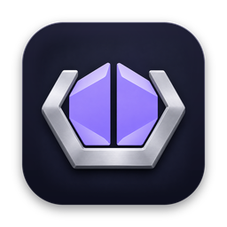
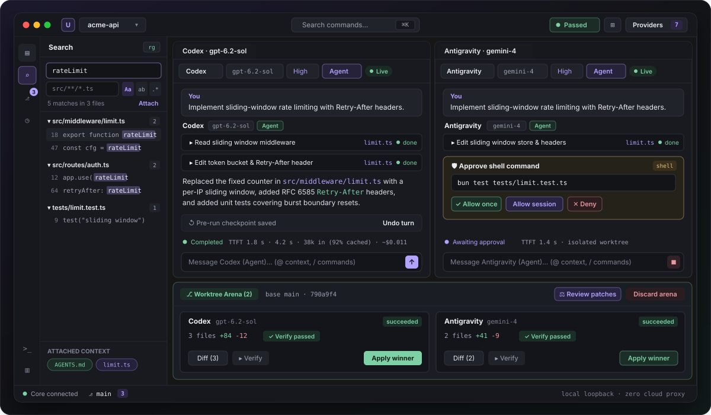
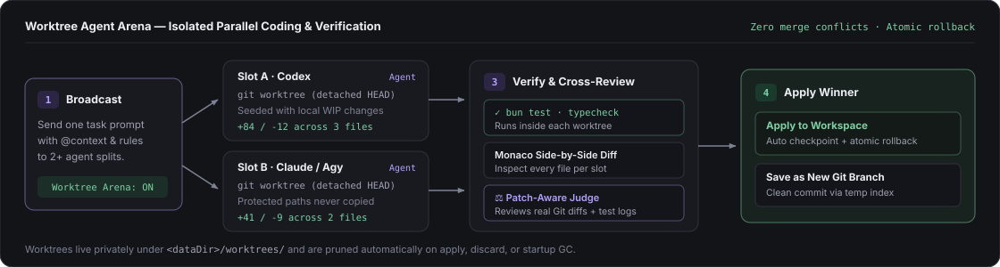

<p align="center">
  
</p>

<h1 align="center">Uya</h1>

<p align="center">
  <strong>The local-first multi-agent AI workbench for macOS and Windows.</strong><br />
  Run Codex, Claude Code, Antigravity, Gemini, OpenCode, and local models side-by-side — with live workspace exploration, isolated Git Worktree Arenas, inline tool approvals, ripgrep search, built-in Git, and reversible checkpoints.
</p>

<p align="center">
  <em>Named after Kazakh <strong>ұя</strong> ("nest") — one calm, native home for all your coding agents.</em>
</p>

<p align="center">
  <a href="README.md"><strong>English</strong></a> · <a href="README.kk.md">Қазақша</a> · <a href="docs/arena.md">Worktree Arena</a> · <a href="docs/providers.md">Providers</a> · <a href="docs/architecture.md">Architecture</a> · <a href="docs/security.md">Security</a>
</p>

<p align="center">
  <a href="https://github.com/akenoowww/uya/releases/latest"></a>
  <a href="https://github.com/akenoowww/uya/actions/workflows/ci.yml"></a>
  
  
  <a href="LICENSE"></a>
</p>

<p align="center">
  
</p>

---

## Why Uya?

Modern AI engineering rarely relies on a single model. You might ask **Codex** to implement a feature, **Claude Code** to refactor edge cases, **Antigravity** to audit security, and **Ollama** or **MLX** to test prompts offline — all using the CLI subscriptions and local weights you already have.

Instead of juggling five terminal tabs or pasting code across browser windows, **Uya** gives you a single native Tauri workbench where every agent shares your project safely, keeps warm persistent sessions, and can even race head-to-head in isolated Git worktrees before a single line touches your main branch.

- **Zero cloud proxy, zero extra account**: Uses your existing CLI sign-ins and local `127.0.0.1` inference servers directly.
- **Explicit safety boundaries**: Switch any split between **Isolated**, **Explore (read-only)**, and **Agent (edit + approvals)** at any time.
- **Built for daily shipping**: Ripgrep search, local Git client with AI commit messages, Monaco multi-file Diff/Apply, one-click Verify runner, and one-click turn Undo.

---

## Core Capabilities

### 1. Three Workspace Access Modes (Per Split)

Every split lets you decide exactly how much workspace access an agent gets — without restarting the app:

| Mode | Working Directory | Tool Access | Safety Guardrails | Best For |
| --- | --- | --- | --- | --- |
| **Isolated** (`Chat`) | Disposable `mkdtemp` scratch dir | `0` tools; explicit `@context` only | Complete filesystem isolation | Sensitive snippets, pure brainstorming, local HTTP models |
| **Explore** (`Read-Only`) *(default for workspaces)* | Open project folder | Read files, glob, ripgrep/search | All file writes & mutating shell commands blocked | Codebase Q&A, bug investigation, architecture review |
| **Agent** (`Edit`) | Open project folder (or Worktree Arena slot) | Read, search, edit files, shell | **Inline approval cards** (`Allow once` / `Allow session` / `Deny`) + **automatic pre-run checkpoint** | Implementing features, writing tests, refactors |

> Stateless providers and local HTTP models (`Ollama`, `llama.cpp`, `MLX`, `LM Studio`, `Gemini API`, `Qwen Code`) automatically receive an optional compact **`@workspace-map`** (<= 6 KiB 2-level project tree + active file) so they understand your repo layout even without native tools.

---

### 2. Worktree Agent Arena (Parallel Isolated Coding)

Toggle **Worktree Arena** in the Broadcast composer (`⌘⇧B` / `Ctrl+Shift+B` or `/arena on`) to let multiple agents solve the same task concurrently in **separate `git worktree` sandboxes** — seeded with your uncommitted local work-in-progress, verified by your own test commands, cross-reviewed on real Git diffs, and applied atomically.

<p align="center">
  
</p>

- **Zero edit collisions**: Each split gets its own detached worktree under `<dataDir>/worktrees/` (protected files like `.env*` and keys are never copied).
- **Verify every candidate**: Run auto-detected project checks (`bun test`, `tsc`, `cargo test`, `pytest`, etc.) inside each worktree before deciding.
- **Patch-aware Judge**: Click **Review patches** (`/judge`) to feed every slot's **actual unified Git diff** + verification pass/fail output to an arbiter model.
- **Safe winner apply**: Apply directly to your workspace (with an automatic reversible checkpoint and atomic rollback) or publish cleanly as a new Git branch.

Read the full guide in [docs/arena.md](docs/arena.md).

---

### 3. Persistent Live Sessions, Tool Cards & Reversible Checkpoints

- **Warm sessions & prompt cache hits**: ACP agents (`agy`) stay warm in `AcpSessionPool`, while **Codex** and **Claude Code** resume native CLI sessions across turns — displaying live cache-hit ratios (`92% cached`) and estimated run cost in both transcripts and Usage Insights.
- **Structured tool cards & inline approvals**: Watch agents read, search, edit, or execute commands in collapsible cards with clickable file links. When an ACP agent requests a mutating action, approve once, allow for the session, or deny directly inline.
- **One-click turn rollback (`/undo`)**: Every `Agent` turn automatically snapshots affected files before edits begin, letting you roll back any turn safely from the transcript or command palette.

---

### 4. Daily-Driver IDE Tools Built In

- **Workspace Code Search (`⌘⇧F` / `Ctrl+Shift+F`)**: Powered by **ripgrep (`rg --json`)** with a confined native TypeScript fallback — case/word/regex/glob filters, jump-to-line in Monaco, and one-click attach of matching files to prompt context.
- **Full Local Git Client (`⌘⇧G` / `Ctrl+Shift+G`)**: Stage/unstage individual files or all changes, discard with confirmation, switch or create branches (also available in the bottom status bar), inspect commit history, and generate Conventional Commit messages with one click.
- **Verification Runner & Auto-Fix Loop**: Auto-detects scripts from `package.json`, `Cargo.toml`, `pyproject.toml`, `go.mod`, and `Makefile`. Run checks asynchronously from the titlebar popover or `/verify`; if a test fails, click **Send failure to agent** to attach `@verify` output straight to the active split.
- **Monaco Multi-File Diff / Apply & Smart Code Actions**: Preview and apply single-file or multi-file unified `diff` patches directly in Monaco; shell code blocks (`sh`, `bash`, `zsh`, `powershell`) offer **Run in Terminal** to execute straight in Uya's native PTY instead of a broken diff view.
- **History 2.0, Prompt Library & Routing**: SQLite FTS5 search across all turns, thread Resume & Fork, versioned `.ai/prompts/` templates with `{{variables}}`, rule-based routing, fallback chains, and Usage & Cost analytics.

---

## Supported Providers & Local Runtimes

| Provider | Isolated | Explore (Read-Only) | Agent (Edit) | Live Session | Effort Controls | Interactive TUI |
| --- | :---: | :---: | :---: | :---: | :---: | :---: |
| **Codex** (`codex`) | ✓ | ✓ | ✓ | ✓ (CLI resume) | Live / `minimal`–`max` | ✓ |
| **Claude Code** (`claude`) | ✓ | ✓ | ✓ | ✓ (CLI resume) | Live / `low`–`max` | ✓ |
| **Antigravity** (`agy`) | ✓ | ✓ | ✓ *(Inline ACP)* | ✓ (ACP pool) | Live per-model | ✓ |
| **Gemini CLI** (`gemini`) | ✓ | ✓ | ✓ | — | Live | ✓ |
| **OpenCode** (`opencode`) | ✓ | ✓ | ✓ | — | — | ✓ |
| **Gemini API** (`gemini-api`) | ✓ | Map | — | — | Live thinking | ✓ |
| **Qwen Code** (`qwen`) | ✓ | Map | — | — | Live ACP | ✓ |
| **Ollama** · **llama.cpp** · **MLX** · **LM Studio** | ✓ | Map | — | — | `minimal`–`high` | When installed |
| **Custom CLI** | macOS sandbox | — | — | — | — | macOS & Windows |
| **Kimi Code** (`kimi`) | — | — | — | — | — | ✓ |

See [docs/providers.md](docs/providers.md) for exact adapter flags, live discovery details, local loopback ports, and Custom CLI sandboxing.

---

## Download & Quickstart

### 1. Install Uya

Download the latest native installer from [GitHub Releases](https://github.com/akenoowww/uya/releases/latest):

| Platform | Recommended Package | Alternative |
| --- | --- | --- |
| **macOS 13+ (Apple Silicon)** | `Uya-<version>-macos-arm64.dmg` | `.app.zip` |
| **macOS 13+ (Intel)** | `Uya-<version>-macos-x64.dmg` | `.app.zip` |
| **Windows 10/11 (64-bit)** | `Uya-<version>-windows-x64-setup.exe` *(per-user, no admin)* | `.msi` |

<details>
<summary>First-launch Gatekeeper / SmartScreen &amp; SHA-256 verification</summary>

- **macOS**: Drag **Uya** into **Applications**. If Gatekeeper blocks the first launch, verify the checksum and follow [Apple's Open Anyway instructions](https://support.apple.com/en-us/102445).
- **Windows**: WebView2 is preinstalled on Windows 11 (bootstrapped automatically on Windows 10). If SmartScreen prompts, verify the checksum and select **More info → Run anyway**.
- **Verify checksums** against `SHA256SUMS.txt`:
  ```sh
  # macOS
  shasum -a 256 -c SHA256SUMS.txt --ignore-missing
  ```
  ```powershell
  # Windows PowerShell
  Get-ChildItem Uya-*-windows-x64-setup.exe | Get-FileHash -Algorithm SHA256
  ```
- **In-app updates**: Signed GitHub Release builds check for updates in the background and prompt **Restart to Update** when ready (or trigger **Check for Updates** from `⌘K` / `Ctrl+K`).

</details>

### 2. Run Your First Multi-Agent Session (60 seconds)

1. **Open a project folder** (`⌘O` / `Ctrl+O`) — Uya auto-detects your installed CLIs, local model servers, Git branch, project rules (`AGENTS.md` / `CLAUDE.md` / `GEMINI.md` / `.uya/rules.md`), and verification scripts.
2. **Pick providers & modes** — Open two splits (`⌘\` / `Ctrl+\`), select e.g. **Codex** and **Claude Code** or **Antigravity**, and choose **Explore** (safe codebase Q&A) or **Agent** (edits with approvals & checkpoints).
3. **Broadcast or launch an Arena** — Press `⌘⇧B` (`Ctrl+Shift+B`), toggle **Worktree Arena**, and send a coding task. Verify each branch, cross-review diffs with `/judge`, and click **Apply winner**.

---

## Keyboard Shortcuts & Slash Commands

<details>
<summary>Essential shortcuts &amp; inline slash commands</summary>

### Keyboard Shortcuts

| Action | macOS | Windows |
| --- | --- | --- |
| Command Palette | `⌘K` | `Ctrl+K` |
| Quick Open File | `⌘P` | `Ctrl+P` |
| Search Workspace (`rg`) | `⌘⇧F` | `Ctrl+Shift+F` |
| Toggle Broadcast / Arena Composer | `⌘⇧B` | `Ctrl+Shift+B` |
| New Model Split | `⌘\` | `Ctrl+\` |
| New Conversation (resets live session) | `⌘N` | `Ctrl+N` |
| Focus Split 1–9 | `⌘1`–`⌘9` | `Ctrl+1`–`Ctrl+9` |
| Toggle Git Sidebar | `⌘⇧G` | `Ctrl+Shift+G` |
| Toggle History &amp; Threads | `⌘⇧H` | `Ctrl+Shift+H` |
| Toggle Split Interactive Terminal | `⌘⇧T` | `Ctrl+Shift+T` |
| Open Shell Terminal | `⌘J` | `Ctrl+J` |
| Cancel Active Run | `⌘.` | `Ctrl+.` |

### Inline Slash Commands

| Command | Description |
| --- | --- |
| `/mode <isolated\|explore\|agent>` | Switch active split workspace access mode |
| `/arena [on\|off\|discard]` | Toggle or discard Worktree Agent Arena |
| `/search <query>` | Open workspace search with query |
| `/verify [command]` | Run default verification preset or custom command |
| `/undo` | Restore the latest pre-run workspace checkpoint |
| `/model <version>` | Switch model version (or `/model default`) |
| `/effort <level>` | Set reasoning effort (`auto`, `minimal`, `low`, `medium`, `high`, `xhigh`, `max`) |
| `/judge` | Cross-review or synthesize latest broadcast or arena patches |
| `/new` | Start a fresh conversation and close active live session |

</details>

---

## Build from Source

Requires **Bun 1.3.14+**, **Node.js 20.19+** (or **22.12+**), **stable Rust (1.91+)**, plus Xcode Command Line Tools on macOS or Visual Studio C++ Build Tools + WebView2 on Windows.

```sh
git clone https://github.com/akenoowww/uya.git
cd uya
bun install --frozen-lockfile
bun run desktop:dev
```

Build standalone native installers (bundling the compiled `uya-core` sidecar):

```sh
bun run desktop:build
```

Run the complete verification suite (typecheck, 280+ unit tests, loopback & RPC smoke tests, production web build, and Rust crate tests):

```sh
bun run check
bun run desktop:test
```

---

## Documentation

- **[Architecture](docs/architecture.md)** — Tauri shell, loopback Bun sidecar, ACP session pool, SQLite v4 schema, and async verification flow.
- **[Worktree Agent Arena](docs/arena.md)** — Isolated parallel coding, WIP seeding, per-slot verification, patch cross-review, and atomic winner apply.
- **[Providers & Local Runtimes](docs/providers.md)** — Full adapter capability matrix, access mode flags, live discovery, and Custom CLI sandboxing.
- **[Security Model](docs/security.md)** — Loopback bearer auth, workspace confinement, protected paths, hardened Git execution, and fail-closed approvals.
- **[Contributing](CONTRIBUTING.md)** & **[Security Policy](SECURITY.md)** — PR guidelines, release signing, and vulnerability disclosure.

## License

Licensed under the [Apache License 2.0](LICENSE).
