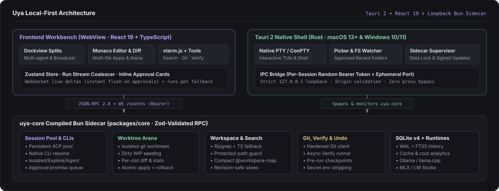

# Architecture

Uya is a local-first desktop workbench built as a three-layer architecture with strict security boundaries and zero cloud relay servers.

---

## 1. Repository Layout

| Package | Stack | Responsibility |
| --- | --- | --- |
| `apps/desktop` | Tauri 2 (Rust) | Native macOS/Windows window shell, PTY/ConPTY manager, folder picker & recents persistence, filesystem watcher, single-instance lock, sidecar supervisor, signed updater |
| `apps/web` | React 19, TypeScript, Dockview, Monaco, xterm.js, Mantine, Zustand | Split workbench UI, structured transcripts, inline approval cards, Worktree Arena bar, ripgrep Search sidebar, local Git client, Verify popover, Usage Insights |
| `packages/core` | Bun (`uya-core` compiled sidecar), SQLite (`bun:sqlite`), Zod | Loopback JSON-RPC & WebSocket server, workspace confinement, search engine, hardened Git operations, Worktree Arena manager, persistent ACP session pool, CLI/runtime adapters, checkpoints, async Verify runner |
| `packages/protocol` | TypeScript | Shared RPC method contracts, domain types (`ExecutionMode`, `ToolMeta`, `ApprovalRequest`, `ArenaSummary`, `VerifyRun`, `CheckpointSummary`, etc.) |

---

## 2. Runtime Lifecycle & Transport

1. **Startup**: The Rust shell acquires an exclusive file lock on the application data directory and spawns the bundled `uya-core` binary.
2. **Ephemeral Loopback Binding**: `uya-core` binds strictly to `127.0.0.1` on an OS-assigned ephemeral port (`port: 0`), generates a high-entropy random bearer token, and reports `{ url, token }` once over stdout.
3. **Authenticated IPC**: The frontend obtains `{ url, token }` from the Tauri IPC command and uses it for:
   - `POST /rpc` — Zod-validated JSON-RPC 2.0 requests (with `Origin` verification and static safe error messages).
   - `GET /events` (WebSocket) — Real-time run deltas (`text`, `thinking`, `tool`, `approval_request`, `approval_resolved`, `status`) with cursor replay and automatic `runs.get` polling fallback.
   - `runStreams.ts` coalesces rapid text frames on `requestAnimationFrame` while flushing `approval_request` and `approval_resolved` events immediately so interactive approvals appear with zero frame delay.

---

## 3. Execution Modes & Persistent Sessions

Each split chooses an `ExecutionMode`:

- **`isolated`**: Runs inside a disposable `mkdtemp("uya-run-")` scratch directory with tools disabled. Only explicitly attached `@file`, `@git-diff`, `@terminal`, selection, or compact `@workspace-map` content is provided.
- **`read-only` (Explore)**: Runs directly against the open workspace directory with read/search tools enabled and all file mutations / shell writes denied at both the adapter and ACP permission layer. Default mode when a workspace folder is open and the provider supports it.
- **`agent`**: Runs against the open workspace (or an isolated Git worktree inside Worktree Arena) with interactive inline approval prompts (`allow_once`, `allow_session`, `reject`) and automatic pre-run workspace checkpoints.

### Session Persistence & Prompt Caching
- **ACP Session Pool (`packages/core/src/session-pool.ts`)**: Keeps warm ACP child processes (e.g., Antigravity `agy acp`) alive per `(provider, conversationId, workspacePath, accessMode, model, effort)` key with a 10-minute idle TTL and LRU cap of 8 processes. Follow-up turns send only the new user message instead of replaying full history.
- **Native CLI Resume**: Codex (`codex exec resume <session_id>`) and Claude Code (`claude --resume <session_id>`) persist native session IDs in SQLite (`provider_sessions`) and transparently fall back to a fresh session if a CLI session expires.

---

## 4. Storage Schema (SQLite v4)

All local state is stored in a single WAL-mode SQLite database with versioned migrations (`packages/core/src/history-migrations.ts`):

| Table | Purpose |
| --- | --- |
| `runs`, `run_events`, `runs_fts` | Complete turn history, structured tool metadata, cached input tokens, estimated cost USD, and FTS5 full-text search index |
| `provider_sessions` | Native CLI / ACP session bindings per `(conversation_id, workspace_path, provider_id, access_mode)` |
| `checkpoints` | Reversible pre-run workspace snapshots (`git` or plain-folder manifests) with one-click restore metadata |
| `arenas` | Worktree Arena sessions, base branch/commit, per-slot diff stats, verification outcomes, and apply status |
| `custom_providers`, `routing_rules` | User-registered CLI commands and declarative routing rules |

---

## 5. Verification Engine & Long-Running Tasks

Frontend RPC calls enforce a 20-second timeout (`apps/web/src/bridge.ts`). Long-running project verification checks (`verify.start`) execute asynchronously in `VerifyManager` (`packages/core/src/verify.ts`):

1. `verify.start` spawns the command (with sensitive API/cloud environment variables stripped) and returns a `VerifyRun` immediately.
2. The UI polls `verify.get` every 350ms for live output (capped at 128 KiB per run) and supports instant cancellation (`verify.cancel`).
3. Verification presets are auto-discovered from `package.json` scripts, `Cargo.toml`, `pyproject.toml`, `go.mod`, and `Makefile`.
4. When a check fails, **Send failure to agent** attaches the exact command, exit code, and output as `@verify` context to the active split.
