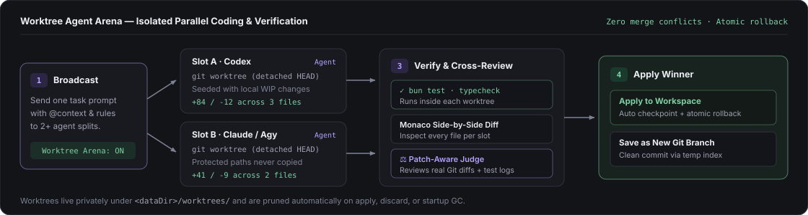

# Worktree Agent Arena

**Worktree Agent Arena** lets you broadcast a single coding task to two or more AI agents simultaneously — **each coding in its own isolated Git worktree** — verify every candidate against your test suite, cross-review real Git diffs with a Judge model, and atomically apply the winning patch to your workspace or a new Git branch.

---

## Why Worktree Arena?

Comparing two models on a real coding task normally fails in one of two ways:
- **Chat-only comparison** produces code snippets that never touch your repository, miss imports, and can't be tested.
- **Shared-workspace execution** causes agents to overwrite each other's edits and corrupt your working tree.

Worktree Arena solves both by pairing Uya's **Broadcast** composer with native `git worktree` isolation.

---

## Step-by-Step Workflow

### 1. Arm Worktree Arena
1. Open any Git repository folder in Uya.
2. Open two or more structured splits with coding agents (for example **Codex** + **Claude Code**, or **Codex** + **Antigravity**).
3. Expand the Broadcast bar (`⌘⇧B` / `Ctrl+Shift+B`) and toggle **Worktree Arena** (or run `/arena on`).

### 2. Isolated Worktree Creation & WIP Seeding
When you submit your prompt:
- `WorktreeArenaManager` (`packages/core/src/worktrees.ts`) creates a detached `git worktree` per split under `<dataDir>/worktrees/<arenaId>/<slotId>` from your current `HEAD`.
- If you have uncommitted local work-in-progress changes in your workspace, Uya seeds non-protected modified and untracked files into each worktree so every agent sees the exact state you are working on — without touching your real working tree.
- Protected paths (`.env*`, private keys, credentials, `.git/`) are **never** copied into worktrees.

### 3. Parallel Agent Execution
Each split runs in **`agent`** mode pointed exclusively at its own worktree path:
- Agents read files, edit code, and run tools independently with zero file-lock or edit conflicts.
- As each agent finishes, Uya computes per-slot file counts, line additions/deletions, and changed file lists via `git status` and `git diff --numstat`.

### 4. Inspect Diffs, Verify & Cross-Review Patches
The **Arena Bar** appears automatically above the composer:
- **Monaco Side-by-Side Diff**: Click **Diff (N)** on any slot to inspect every modified or newly created file directly in Monaco's diff editor (`arena.slotDiff`).
- **Parallel Verification**: Select an auto-detected preset (e.g., `typecheck`, `test`, `build`, `cargo test`) or enter a custom command and click **Verify** or **Verify all slots**. Each verification runs inside that slot's isolated worktree via `verify.start`.
- **Patch-Aware Cross-Review (Judge)**: Click **Review patches** (or `/judge`) to send the **actual unified Git diffs**, verification pass/fail summaries, and agent explanations from all changed slots to an arbiter model (*Find bugs & gaps*, *Synthesize best*, or *Pick winner*).

### 5. Apply Winner or Discard
When you pick the winning slot, choose **Apply winner**:
- **Apply to main workspace**:
  1. Verifies that the target workspace has no unexpected conflicting edits.
  2. Automatically creates a **reversible pre-apply checkpoint** (`checkpoints.create`).
  3. Atomically copies added/modified files and removes deleted files — rolling back automatically if any filesystem operation fails.
  4. Prunes all arena worktrees cleanly.
- **Save as new Git branch**:
  - Builds a clean commit from the winning slot using an isolated temporary `GIT_INDEX_FILE` (`git write-tree` + `git commit-tree`) and updates a new local branch without disturbing your current working tree or `HEAD`.
- **Discard arena** (`/arena discard`):
  - Cleanly removes every worktree and marks the arena discarded without altering your repository.

---

## Lifecycle & Cleanup Guarantees

- Worktrees are stored outside your project directory (under Uya's private app data directory) so they never pollute your repository or trigger recursive watchers.
- On sidecar startup, Uya prunes stale or orphaned worktree directories automatically and runs `git worktree prune` cleanly.
